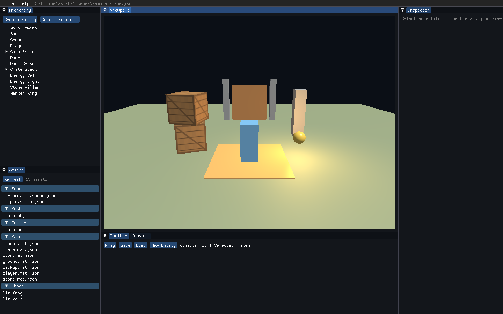
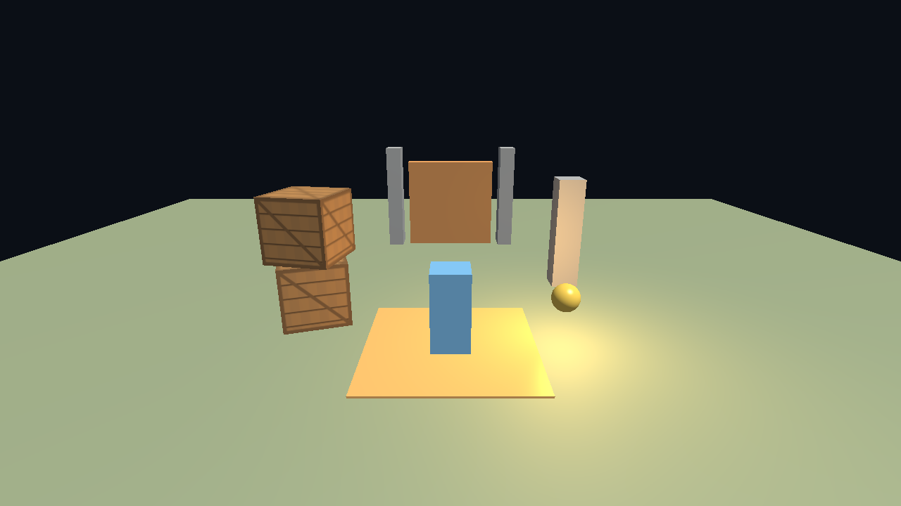

# L3D Engine

L3D Engine 是一个面向软件体系结构课程设计的轻量 3D 游戏引擎。项目重点不是功能数量，而是通过一个可运行的纵向切片展示模块边界、单向依赖、接口隔离、错误隔离、可替换性和可验证性。

| 属性 | 内容 |
|---|---|
| 目标平台 | Windows 10/11 x64 |
| 核心技术 | C++20、OpenGL 4.1 Core、GLFW、glad、glm、Dear ImGui、CMake、MSVC |
| 脚本方案 | C# / .NET 10 NativeAOT，通过固定 C ABI 与 C++ 引擎交互 |
| 架构风格 | 分层模块化单体 + 稀疏集合 ECS + 同步事件 + C ABI 插件边界 |
| 示例闭环 | 第三人称移动、碰撞、拾取、触发开门、播放/停止恢复 |
| 当前状态 | Debug/Release 构建成功，CTest 16/16 通过 |

## 快速预览





## 已实现范围

| 领域 | 实现内容 |
|---|---|
| 核心运行时 | `Result<T>`、日志、事件总线、固定 60 Hz 时间步、输入快照、GUID、文件工具 |
| 平台层 | GLFW 窗口、键鼠输入、隐藏窗口、OpenGL 4.1 上下文、可选 VSync |
| ECS 与场景 | 32 位索引 + generation 实体、类型级稀疏集合、层级变换、场景 JSON 读写、Play 快照 |
| 资产管线 | `.meta.json` GUID、启动/手动扫描、OBJ、PNG、材质 JSON、缓存和 GUID 解析 |
| 渲染 | 离屏 FBO、Blinn-Phong、方向光、环境项、最多 8 个点光、纹理、内置立方体/平面/球体 |
| 物理 | 世界轴 AABB、球体、触发器、射线、重力、跳跃、运动学角色控制、进入/离开事件 |
| 脚本 | NativeAOT DLL 加载、ABI 版本校验、脚本目录、实例生命周期、异常隔离 |
| 编辑器 | Hierarchy、Inspector、Assets、Console、Viewport、选择、创建/删除实体、Play/Stop、保存/加载 |
| 示例玩法 | 玩家移动、跟随相机、碰撞、拾取物、触发门、层级道具、纹理箱体 |
| 自动化工具 | 隐藏窗口运行、帧数限制、PNG 截图、500 实体性能场景生成器 |

## 环境要求

| 依赖 | 建议版本 | 说明 |
|---|---|---|
| Windows | 10/11 x64 | 当前只承诺该平台 |
| Visual Studio 2022 | 17.x，含“使用 C++ 的桌面开发” | 提供 MSVC 与 Windows SDK |
| CMake | 3.25 或更高 | 项目使用 CMake Presets |
| .NET SDK | 10.x | 用于 NativeAOT 发布 `GameScripts.dll` |
| Git | 任意近期版本 | 首次配置时 FetchContent 获取依赖 |
| GPU 驱动 | 支持 OpenGL 4.1 Core | 需要可用的图形驱动 |

第三方库由 CMake FetchContent 获取：GLFW 3.4、glm 1.0.1、nlohmann/json 3.11.3、Dear ImGui 1.91.9b-docking、Catch2 3.7.1。首次配置需要网络访问。

## 构建

在仓库根目录执行：

```powershell
cmake -S . -B build -G "Visual Studio 17 2022" -A x64 -DBUILD_TESTING=ON
cmake --build build --config Debug --parallel 6
ctest --test-dir build -C Debug --output-on-failure
```

Release 构建：

```powershell
cmake --build build --config Release --parallel 6
ctest --test-dir build -C Release --output-on-failure
```

构建产物位于：

| 产物 | 路径 |
|---|---|
| 引擎程序 | `build/bin/Debug/engine_app.exe` 或 `build/bin/Release/engine_app.exe` |
| 测试程序 | `build/bin/<Config>/engine_tests.exe` |
| C# 插件 | `build/bin/<Config>/GameScripts.dll` |
| 运行资源副本 | `build/bin/<Config>/assets/` |

CMake 会自动调用 `dotnet publish` 构建 NativeAOT 插件。修改 C# 脚本后，需要重新构建并重启引擎；当前不支持热重载。

## 运行

### 编辑器模式

```powershell
build\bin\Debug\engine_app.exe
```

默认加载 `assets/scenes/sample.scene.json`。也可以显式指定场景：

```powershell
build\bin\Debug\engine_app.exe --scene assets\scenes\sample.scene.json
```

### 运行模式

```powershell
build\bin\Debug\engine_app.exe --runtime
```

隐藏窗口运行 300 帧，用于冒烟测试：

```powershell
build\bin\Debug\engine_app.exe --runtime --hidden --no-vsync --frames 300
```

### 常用参数

| 参数 | 作用 |
|---|---|
| `--runtime` | 跳过编辑器，直接运行场景 |
| `--hidden` | 创建隐藏窗口，适合自动化冒烟测试 |
| `--no-vsync` | 关闭垂直同步 |
| `--frames <N>` | 渲染 N 帧后自动退出 |
| `--scene <file>` | 指定 `.scene.json` 场景 |
| `--assets <dir>` | 指定资产根目录 |
| `--screenshot <file>` | 在渲染若干帧后写出默认帧缓冲 PNG |

## 操作说明

| 模式 | 操作 | 行为 |
|---|---|---|
| 编辑器 | 鼠标左键点击视口/Hierarchy | 选择实体 |
| 编辑器 | 视口内按住鼠标右键 + 鼠标移动 | 旋转编辑器相机 |
| 编辑器 | 视口内 `W/A/S/D` | 前后左右飞行 |
| 编辑器 | 视口内 `Q/E` | 下降/上升 |
| 编辑器 | 按住 `Shift` | 加速相机 |
| 编辑器 | 工具栏 `Play` / `Stop` | 进入/退出 Play 模式 |
| Runtime/Play | `W/A/S/D` | 玩家移动 |
| Runtime/Play | `Space` | 跳跃 |
| Runtime | `Escape` | 退出运行模式 |

## 示例闭环

1. 启动编辑器，确认 Hierarchy 中能看到 `Player`、`Main Camera`、`Door`、`Energy Cell` 等实体。
2. 选中 `Player`，在 Inspector 中查看/编辑 Transform、Character Controller 和 Script 属性。
3. 点击 `Play`，使用 `W/A/S/D` 移动玩家。
4. 向右前方靠近黄色能量球，触发 `Pickup` 脚本，实体被销毁并输出拾取日志。
5. 继续前进到门前，进入 `Door Sensor` 触发器，`DoorTrigger` 抬高门体。
6. 停止 Play，场景恢复到播放前快照；运行期间产生的修改不会写回场景。
7. 点击 `Save` 保存场景，再点击 `Load` 重新加载，验证场景可重复打开。

## 测试与验收

```powershell
ctest --test-dir build -C Debug --output-on-failure
ctest --test-dir build -C Release --output-on-failure
```

本次验收结果：

| 项目 | 结果 |
|---|---|
| Debug CTest | 16/16 通过 |
| Release CTest | 16/16 通过 |
| 全新目录构建 | CMake 首次配置、Debug 构建和 CTest 16/16 通过 |
| Debug 性能场景 | 1000 帧 / 3.519 秒，约 284.2 FPS（3 次中位数） |
| Release 性能场景 | 1000 帧 / 0.674 秒，约 1482.7 FPS（3 次中位数） |
| 性能场景规模 | 500 实体、101 个 `MeshRenderer`、1280×720、无 VSync |
| 运行时冒烟 | 16 实体、4 个 C# 脚本实例、OBJ/PNG/材质正常加载 |
| 编辑器冒烟 | 隐藏窗口 120 帧无崩溃 |

详细的测试矩阵、验收记录和已知限制见 `docs/05-test-report.md`。

## 架构摘要

```text
engine_app（组合根、主循环、Editor/Runtime 模式）
├─ engine_editor（ImGui 面板、选择、Play 模式控制）
├─ engine_renderer（RenderFrame -> OpenGL Forward Renderer）
├─ engine_physics（AABB/球体、射线、触发器、角色移动）
├─ engine_scripting（C ABI 宿主）── GameScripts.dll（C# NativeAOT）
├─ engine_scene（ECS、组件、层级、场景序列化）
├─ engine_assets（GUID、OBJ/PNG、材质）
├─ engine_platform（窗口、输入、时间）
└─ engine_core（Result、日志、事件、GUID）
```

| 规则 | 约束 |
|---|---|
| 组合根 | 只有 `engine_app` 负责创建和装配具体子系统 |
| 编辑器反向依赖 | 运行时模块不得依赖 `engine_editor` |
| 渲染解耦 | 场景只输出 `RenderFrame`/`RenderItem`，渲染器不访问 ECS |
| 脚本边界 | C# 只通过 `EngineApiV1` 函数表访问引擎，不引用 C++ 头文件 |
| 错误边界 | C++ 模块边界返回 `Result<T>` 或状态码；C ABI 不传播异常 |
| 线程模型 | 输入、模拟、脚本、渲染和 ImGui 全部在主线程执行 |

## 资产与脚本

| 类型 | 格式 | 说明 |
|---|---|---|
| 场景 | `.scene.json` | 实体、组件、层级、脚本名称和参数字符串 |
| 资产元数据 | `.meta.json` | GUID、资产类型、导入器版本 |
| 材质 | `.mat.json` | 颜色、镜面颜色、光泽度、反照率贴图 GUID |
| 网格 | `.obj` | 仅位置、法线、UV、索引；忽略 MTL；凸多边形会三角化 |
| 贴图 | `.png` | 使用 stb_image 解码 |
| 着色器 | `.vert` / `.frag` | OpenGL 4.1 GLSL；资源缺失时使用内置回退着色器 |

## 已知限制

| 限制 | 说明 |
|---|---|
| 单一平台 | 只实现 Windows x64，不承诺跨平台 |
| 无热重载 | 修改 C# 脚本后需要重新构建并重启 |
| 物理范围有限 | 不支持旋转 OBB、关节、连续碰撞和完整刚体角动量 |
| 渲染范围有限 | 无 PBR、阴影、全局光照、骨骼动画、地形和后处理 |
| 编辑器范围有限 | 无多级撤销重做、拖拽 Gizmo、材质节点编辑和发布打包 |
| 脚本创建实体 | C# 可创建带 Transform/Tag 的实体；不能在同一 Play 会话中动态挂载新脚本类型 |
| 手工 UI 验收 | 自动化覆盖状态转换和渲染路径；完整可见窗口交互仍需按演示文档人工确认 |

## 课程设计文档

| 文档 | 内容 |
|---|---|
| `docs/01-requirements.md` | 需求、质量属性、约束和验收追踪 |
| `docs/02-architecture.md` | 上下文、模块依赖、运行时顺序、ECS、编辑器和错误边界 |
| `docs/03-adr.md` | 模块化单体、稀疏 ECS、固定 C ABI、场景快照等架构决策 |
| `docs/04-interfaces.md` | 模块接口、场景/材质格式、C ABI 契约 |
| `docs/05-test-report.md` | 自动测试、ABI 测试、渲染冒烟、性能和验收记录 |
| `docs/06-demo.md` | 5–10 分钟演示流程、讲解要点和答辩问答 |
| `docs/07-learning-guide.md` | 从零阅读源码的教学路线、调用链、练习和自测题 |
