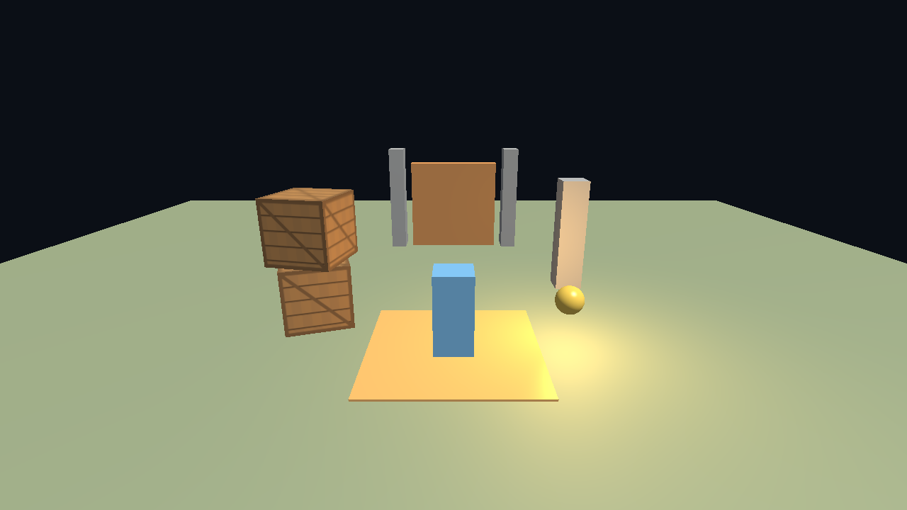
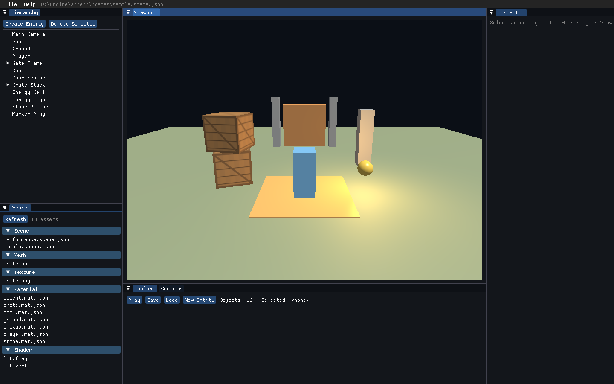
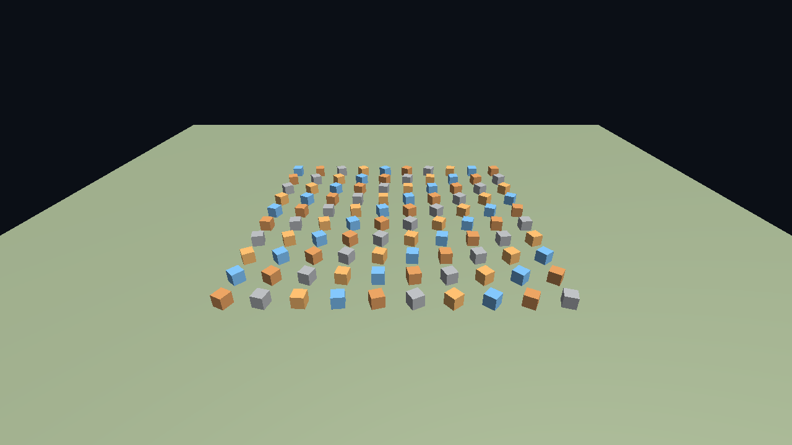

# 测试报告

## 1. 测试环境

| 项目 | 配置 |
|---|---|
| 操作系统 | Windows NT 10.0.26200 x64 |
| CPU | 13th Gen Intel Core i9-13900HX，24 核 / 32 逻辑处理器 |
| GPU | NVIDIA GeForce RTX 4060 Laptop GPU，OpenGL 4.1.0，驱动 616.92 |
| 编译器 | MSVC 19.44（Visual Studio 2022） |
| CMake | 4.3.1-msvc1 |
| .NET SDK | 10.0.401，NativeAOT 可用 |
| 构建配置 | Debug 与 Release |
| 测试框架 | Catch2 3.7.1 + CTest |
| 测试日期 | 2026-10-20 |

## 2. 自动测试结果

### 2.1 汇总

| 配置 | 通过 | 失败 | 总耗时 | 结论 |
|---|---:|---:|---:|---|
| Debug | 16 | 0 | 1.71 秒 | 通过 |
| Release | 16 | 0 | 1.49 秒 | 通过 |

命令：

```powershell
ctest --test-dir build -C Debug --output-on-failure
ctest --test-dir build -C Release --output-on-failure
```

另于 2026-10-20 在全新 `build-fresh` 目录按 README 命令完成首次配置与 Debug 构建，CTest 为 16/16 通过（1.86 秒），确认构建流程不依赖旧缓存。

### 2.2 测试矩阵

| 编号 | 测试名称 | 覆盖点 | Debug | Release |
|---|---|---|---|---|
| T-01 | Entity generations invalidate stale handles and component storage is reusable | generation、删除复用、组件池 | 通过 | 通过 |
| T-02 | World copy keeps entities and components independent | 深拷贝、Play 快照基础 | 通过 | 通过 |
| T-03 | Hierarchy transforms propagate and cycles are rejected | 层级传播、循环拒绝 | 通过 | 通过 |
| T-04 | World publishes entity destruction through the synchronous event bus | 销毁事件同步派发 | 通过 | 通过 |
| T-05 | Scene JSON round trip restores components, tags and hierarchy | 场景往返、组件/标签/层级 | 通过 | 通过 |
| T-06 | Invalid scene data returns an error without replacing the current world | 版本/结构错误隔离 | 通过 | 通过 |
| T-07 | Fixed timestep accumulates, clamps and rejects invalid deltas | 60 Hz 累加、最大补步、非法输入 | 通过 | 通过 |
| T-08 | Character controller settles on a collider and trigger enter/exit fires once | 重力、着地、触发器边沿 | 通过 | 通过 |
| T-09 | Raycasts find the nearest box and sphere hit | AABB/球体最近命中 | 通过 | 通过 |
| T-10 | Solid collider enter and exit events are emitted once per transition | 实体碰撞 Enter/Exit 去重 | 通过 | 通过 |
| T-11 | Play session snapshot restores the authored scene | Play 备份与恢复 | 通过 | 通过 |
| T-12 | Asset database imports OBJ, PNG and material metadata | OBJ/PNG/材质/GUID 错误 | 通过 | 通过 |
| T-13 | Performance acceptance scene loads the expected entity and render counts | 500 实体、101 渲染项 | 通过 | 通过 |
| T-14 | Hidden-window OpenGL smoke test verifies color output and depth ordering | 隐藏窗口、像素读回、深度 | 通过 | 通过 |
| T-15 | Script host reports missing and incompatible plugins without crashing | DLL 缺失、ABI 版本不匹配 | 通过 | 通过 |
| T-16 | NativeAOT gameplay ABI drives movement, triggers and exception isolation | 真实 C# 插件端到端、异常隔离 | 通过 | 通过 |

## 3. ABI 与脚本专项验证

T-16 使用真实 `GameScripts.dll`，不是 C++ 假插件；测试读取脚本目录并执行以下场景：

| 场景 | 输入 | 期望 | 结果 |
|---|---|---|---|
| 未知脚本名 | `ScriptComponent{"UnknownScript"}` | 创建失败、记录警告、实例数 0 | 通过 |
| 实体碰撞回调 | 构造 `CollisionEvent` | C# 输出 `CollisionProbe: enter` | 通过 |
| C# 异常的隔离 | `ThrowingScript` | 捕获异常、记录日志、引擎不崩溃 | 通过 |
| 角色移动 | 按 `W` 60 个固定步 | 玩家 Z 轴前进、角色着地 | 通过 |
| 触发器开门 | 玩家进入门传感器 | 门体高度上升 | 通过 |
| 拾取物销毁 | 玩家进入球形触发器 | 实体销毁、输出 `Collected Test Cell` | 通过 |
| 实体创建 | `AbiProbe` 调用 `createEntity` | 新实体带 Tag/Transform、位置正确 | 通过 |
| 射线检测 | `AbiProbe` 向下发射并忽略自身 | 命中目标实体句柄和距离 | 通过 |
| 鼠标与滚轮 | 左键、位移、位置、滚轮 | C# 读到 `left=1`、`delta=3.00,-2.00`、`position=120.00,80.00`、`scroll=1.25` | 通过 |
| Transform 缩放 | 读取默认缩放并写入 +0.5 | 新实体 scale 为 `1.5,1.5,1.5` | 通过 |

ABI 相关错误路径另外由 T-15 验证：

| 场景 | 结果 |
|---|---|
| DLL 不存在 | `load` 返回 `false`，不崩溃 |
| ABI 版本不匹配（假插件返回 2） | 拒绝加载，记录错误，不调用导出函数 |
| 场景仍可加载 | 脚本不可用时场景和渲染路径继续工作 |

## 4. 渲染冒烟测试

T-14 创建隐藏窗口和 OpenGL 上下文，渲染基础几何体并读回颜色/深度信息。

| 检查项 | 标准 | 结果 |
|---|---|---|
| 非清屏颜色 | 读回像素不是纯清屏色 | 通过 |
| 深度顺序 | 前景几何覆盖背景几何 | 通过 |
| 离屏目标 | FBO 颜色/深度附件可用 | 通过 |
| 上下文 | OpenGL 4.1 Core 创建成功 | 通过 |

## 5. 运行时与编辑器冒烟

| 场景 | 命令/配置 | 观测结果 | 结论 |
|---|---|---|---|
| 示例 Runtime | 隐藏窗口、300 帧、无 VSync | 16 实体、4 个 C# 实例、OBJ 导入成功、约 1057.3 FPS | 通过 |
| 编辑器 | 隐藏窗口、120 帧 | 面板、场景和渲染路径无崩溃、约 529.2 FPS | 通过 |
| 截图输出 | `--screenshot` | `docs/images/sample-runtime.png`、`sample-editor.png` 正常写出 | 通过 |

示例场景截图：



编辑器截图：



## 6. 性能验收

### 6.1 场景规模

| 指标 | 数值 |
|---|---:|
| 实体数 | 500 |
| `MeshRenderer` 数 | 101 |
| 分辨率 | 1280×720 |
| VSync | 关闭 |
| 预热/统计 | 每种配置独立运行 3 次，每次 1000 帧，取中位数 |

### 6.2 结果

| 配置 | 帧数 | 总耗时 | 平均 FPS | 结论 |
|---|---:|---:|---:|---|
| Release | 1000 | 0.674 秒 | 1482.7 | 超过 60 FPS 目标 |
| Debug | 1000 | 3.519 秒 | 284.2 | 超过 60 FPS 目标 |

命令：

```powershell
build\bin\Release\engine_app.exe --runtime --hidden --no-vsync --frames 1000 `
  --scene assets\scenes\performance.scene.json
```

性能场景截图：



> 说明：数值为开发机 3 次独立运行的中位数，用于确认没有明显性能退化，不作为跨机器基准。打开 VSync 时帧率受显示器刷新率限制。

## 7. 手工验收清单

以下项目用于答辩前的可见窗口复核。底层状态转换已有自动测试覆盖；UI 点击路径需要在目标机器上人工确认一次。

| 编号 | 操作 | 期望 | 当前状态 |
|---|---|---|---|
| M-01 | 启动编辑器 | 窗口打开，Hierarchy/Assets/Inspector/Console/Viewport 正常 | 已由截图确认 |
| M-02 | 点击 Hierarchy 实体 | Inspector 显示该实体组件 | 待人工确认 |
| M-03 | 修改 Transform/名称/标签 | 视口与面板即时更新 | 待人工确认 |
| M-04 | 点击 `Create Entity`/`Delete Selected` | 实体列表正确变化 | 待人工确认（自动测试覆盖 World 层） |
| M-05 | 点击 `Save` | 场景 JSON 写回 | 待人工确认（序列化测试通过） |
| M-06 | 点击 `Load` | 重新加载并保持组件/层级 | 待人工确认（往返测试通过） |
| M-07 | 点击 `Play` | 标题变为 PLAY，角色可控 | 自动集成测试覆盖玩法；UI 待确认 |
| M-08 | 移动、拾取、开门 | 拾取物消失，门升高 | 自动集成测试通过 |
| M-09 | 点击 `Stop` | 场景恢复到播放前状态 | 自动测试通过 |
| M-10 | 关闭并重开应用 | 示例场景可重复加载 | 待人工确认 |

## 8. 已知问题与限制

| 编号 | 问题 | 影响 | 处理 |
|---|---|---|---|
| L-01 | 阴影未实现 | 视觉真实感有限 | 作为加分项/后续演进，不阻塞核心闭环 |
| L-02 | C# 脚本无热重载 | 修改脚本后需重新构建并重启 | 文档明确说明 |
| L-03 | C# 创建的实体不能在同一 Play 中动态挂载新脚本 | 动态生成玩法对象能力有限 | 当前 ABI 只暴露 Transform/Tag 创建；后续可增加组件 ABI |
| L-04 | 材质未保存独立 shader GUID | 所有材质统一使用 lit shader | 当前渲染范围足够；后续增加 shader 变体缓存 |
| L-05 | 物理不支持旋转 OBB/关节/连续碰撞 | 复杂物理玩法不可用 | 通过 `IPhysicsWorld` 预留替换点 |
| L-06 | 手工 UI 路径未在当前会话完成全部点击复核 | 不能宣称所有可见交互都已人工验收 | 按第 7 节清单在答辩前执行 |

## 9. 结论

| 维度 | 结论 |
|---|---|
| 构建 | Debug/Release 均成功，NativeAOT 插件随构建发布 |
| 核心正确性 | 16/16 自动测试通过，覆盖 ECS、场景、物理、资产、渲染和脚本 |
| 架构边界 | 场景/渲染/物理/脚本/资产接口已隔离，编辑器无反向依赖 |
| 错误隔离 | 场景、资产、DLL 和 C# 异常均有受控失败路径 |
| 性能 | 500 实体性能场景在 Debug/Release 均明显超过 60 FPS 目标 |
| 可演示性 | 示例场景、截图、命令行和演示文档齐全；答辩前完成第 7 节人工点击复核 |
